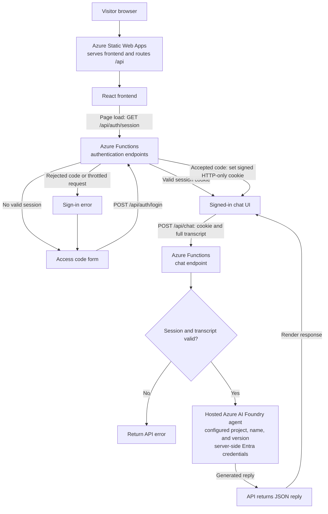

# MikeAI

A personal AI assistant that answers questions about Mike's professional experience using an Azure AI Foundry Agent.

## Stack

- `web/`: React, Vite, and Material UI frontend.
- `api/`: Azure Static Web Apps Functions API, using Node.js 22 or newer.

## How the app works

Azure Static Web Apps serves the frontend and routes same-origin `/api` requests to the Functions API. When the page opens, the frontend checks for a valid session. If the visitor is signed out, they can submit an access code; the API checks it against `ACCESS_CODES` and, when accepted, returns a signed, HTTP-only session cookie that expires after 12 hours. The frontend sends that cookie with API requests, and logout clears it.

The AI agent is hosted in Azure AI Foundry as a separately configured service. Learn more about [Azure AI Foundry Agent Service](https://azure.microsoft.com/en-us/products/ai-foundry/agent-service). The API uses the Foundry project endpoint and configured agent name and version to reach it, authenticating with server-side Microsoft Entra client credentials. For chat, the browser sends the current conversation transcript to `POST /api/chat`. The API verifies the session and validates the message roles and request size, then sends the transcript to the hosted agent. It returns the agent's reply as JSON for the frontend to render. The transcript is held in frontend memory for the current page session; each chat request includes the conversation so far.



## Local setup

From the repository root, install dependencies:

```sh
npm ci --prefix api
npm ci --prefix web
```

Merge the required server settings from `.env.example` into the repository-root `.env`. Keep secrets out of source control. The API loads this file for local development; Azure settings belong in server-side Static Web Apps configuration.

Run the API and frontend in separate terminals:

```sh
npm --prefix api run start
npm --prefix web run dev
```

The API listens on `http://127.0.0.1:7071`. Local API development does not require Azure Functions Core Tools or Azurite.

## Verify the local environment

Run from the repository root. Node.js should report version 22 or newer.

```sh
node --version
npm --version
npm ls --prefix api --depth=0
npm ls --prefix web --depth=0
node --check api/src/index.js
node --check api/src/devServer.js
npm --prefix web run build
```

The web build runs the TypeScript check and creates `web/dist/`.

## Check the production build

The API is deployed as JavaScript source and has no separate build script. Install its production dependencies, build the frontend, then serve the built frontend locally:

```sh
npm ci --omit=dev --prefix api
npm ci --prefix web
npm --prefix web run build
npm --prefix web run preview
```

The preview server checks the frontend build. For a full Azure Static Web Apps integration check, deploy with app location `web`, API location `api`, and output location `dist`.

## Azure configuration

Set `ACCESS_CODES`, `SESSION_SECRET`, `AZURE_AI_PROJECT_ENDPOINT`, `AZURE_AI_AGENT_NAME`, `AZURE_AI_AGENT_VERSION`, `AZURE_TENANT_ID`, `AZURE_CLIENT_ID`, and `AZURE_CLIENT_SECRET` as server-side application settings. Do not expose them as `VITE_*` variables or commit secrets.

Authentication logs include submitted access codes, so restrict log access. Login throttling is per Functions process; configure platform-level rate limiting before broad production use.

## Google Analytics

Google Analytics is optional. Set `VITE_GA_MEASUREMENT_ID` in `web/.env.local` for local frontend builds or in the frontend deployment build environment. The value is public and embedded in the frontend bundle; do not put secrets in `VITE_*` variables. Analytics stays disabled when the variable is empty or invalid. When configured, the app sends a generic page view for `/`; it does not send chat messages or access codes.

Optional profile links are configured with `VITE_LINKEDIN_URL`, `VITE_GITHUB_URL`, and `VITE_CONTACT_URL` in `web/.env.local` or the frontend deployment build environment. LinkedIn defaults to `https://www.linkedin.com/in/mcarroll12/`, GitHub defaults to `https://github.com/BinarySyrup`, and contact defaults to `mailto:mike@binarysyrup.com`. These values are public and embedded in the frontend bundle. LinkedIn and GitHub links must use HTTPS; contact accepts an HTTPS URL or a `mailto:` address. Empty or invalid links are hidden.

Python API documentation: [docs/operations/python-api.md](docs/operations/python-api.md).
